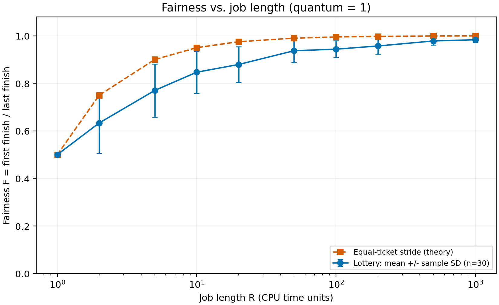

# 第 9 章：彩票调度 Lottery

定义 F=min(T0,T1)/max(T0,T1)，越接近 1 表示完成时刻越接近；完成时间差 D=abs(T0-T1)，越大表示越不公平。此指标用于这里同时到达、等长度、等票数的两个作业。

## 1. 三个作业、种子 1、2、3

先运行不带 -c 的命令读取任务和随机数；逐轮计算随机数对当前存活作业总票数的余数，再根据累计票号区间选出运行者。作业完成后移除其票数，下一轮重新计算票号范围。

### 种子 1

| 作业 | 长度 | 票数 |
| --- | --- | --- |
| 0 | 1 | 84 |
| 1 | 7 | 25 |
| 2 | 4 | 44 |

| 时刻 | 随机数 | 当前总票数 | 中奖彩票 | 运行作业 | 剩余长度 |
| --- | --- | --- | --- | --- | --- |
| 0 | 651593 | 153 | 119 | 2 | 3 |
| 1 | 788724 | 153 | 9 | 0 | 0 |
| 2 | 93859 | 69 | 19 | 1 | 6 |
| 3 | 28347 | 69 | 57 | 2 | 2 |
| 4 | 835765 | 69 | 37 | 2 | 1 |
| 5 | 432767 | 69 | 68 | 2 | 0 |
| 6 | 762280 | 25 | 5 | 1 | 5 |
| 7 | 2106 | 25 | 6 | 1 | 4 |
| 8 | 445387 | 25 | 12 | 1 | 3 |
| 9 | 721540 | 25 | 15 | 1 | 2 |
| 10 | 228762 | 25 | 12 | 1 | 1 |
| 11 | 945271 | 25 | 21 | 1 | 0 |

完成时刻：{0: 2, 2: 6, 1: 12}。逐轮推算与 -c 完全一致。命令为 python3 ext/ostep-homework/cpu-sched-lottery/lottery.py -j 3 -s 1 -c。

### 种子 2

| 作业 | 长度 | 票数 |
| --- | --- | --- |
| 0 | 9 | 94 |
| 1 | 8 | 73 |
| 2 | 6 | 30 |

| 时刻 | 随机数 | 当前总票数 | 中奖彩票 | 运行作业 | 剩余长度 |
| --- | --- | --- | --- | --- | --- |
| 0 | 605944 | 197 | 169 | 2 | 5 |
| 1 | 606802 | 197 | 42 | 0 | 8 |
| 2 | 581204 | 197 | 54 | 0 | 7 |
| 3 | 158383 | 197 | 192 | 2 | 4 |
| 4 | 430670 | 197 | 28 | 0 | 6 |
| 5 | 393532 | 197 | 123 | 1 | 7 |
| 6 | 723012 | 197 | 22 | 0 | 5 |
| 7 | 994820 | 197 | 167 | 2 | 3 |
| 8 | 949396 | 197 | 53 | 0 | 4 |
| 9 | 544177 | 197 | 63 | 0 | 3 |
| 10 | 444854 | 197 | 28 | 0 | 2 |
| 11 | 268241 | 197 | 124 | 1 | 6 |
| 12 | 35924 | 197 | 70 | 0 | 1 |
| 13 | 27444 | 197 | 61 | 0 | 0 |
| 14 | 464894 | 103 | 55 | 1 | 5 |
| 15 | 318465 | 103 | 92 | 2 | 2 |
| 16 | 380015 | 103 | 48 | 1 | 4 |
| 17 | 891790 | 103 | 16 | 1 | 3 |
| 18 | 525753 | 103 | 41 | 1 | 2 |
| 19 | 560510 | 103 | 87 | 2 | 1 |
| 20 | 236123 | 103 | 47 | 1 | 1 |
| 21 | 23858 | 103 | 65 | 1 | 0 |
| 22 | 325143 | 30 | 3 | 2 | 0 |

完成时刻：{0: 14, 1: 22, 2: 23}。逐轮推算与 -c 完全一致。命令为 python3 ext/ostep-homework/cpu-sched-lottery/lottery.py -j 3 -s 2 -c。

### 种子 3

| 作业 | 长度 | 票数 |
| --- | --- | --- |
| 0 | 2 | 54 |
| 1 | 3 | 60 |
| 2 | 6 | 6 |

| 时刻 | 随机数 | 当前总票数 | 中奖彩票 | 运行作业 | 剩余长度 |
| --- | --- | --- | --- | --- | --- |
| 0 | 13168 | 120 | 88 | 1 | 2 |
| 1 | 837469 | 120 | 109 | 1 | 1 |
| 2 | 259354 | 120 | 34 | 0 | 1 |
| 3 | 234331 | 120 | 91 | 1 | 0 |
| 4 | 995645 | 60 | 5 | 0 | 0 |
| 5 | 470263 | 6 | 1 | 2 | 5 |
| 6 | 836462 | 6 | 2 | 2 | 4 |
| 7 | 476353 | 6 | 1 | 2 | 3 |
| 8 | 639068 | 6 | 2 | 2 | 2 |
| 9 | 150616 | 6 | 4 | 2 | 1 |
| 10 | 634861 | 6 | 1 | 2 | 0 |

完成时刻：{1: 4, 0: 5, 2: 11}。逐轮推算与 -c 完全一致。命令为 python3 ext/ostep-homework/cpu-sched-lottery/lottery.py -j 3 -s 3 -c。

## 2. 1 票与 100 票

    python3 ext/ostep-homework/cpu-sched-lottery/lottery.py -l 10:1,10:100 -s 1 -c

两者都存活时 Job 0 每轮中奖概率为 1/101，Job 1 为 100/101。票少者仍有机会在另一个作业完成前运行，并非永远不能运行。

时间片为 1，Job 1 需要中奖 10 次。因此 Job 0 在 Job 1 完成前至少中奖一次的理论概率为 1-(100/101)^10 = 9.4713%。用种子 0 至 199 实测 200 次，其中 20 次出现该事件，频率为 10.00%。有限样本频率存在随机误差。Job 1 完成后移除其票数，Job 0 拥有剩余全部票数并运行到结束。

## 3. 等长度、等票数有多不公平

    python3 ext/ostep-homework/cpu-sched-lottery/lottery.py -l 100:100,100:100 -q 1 -s 0 -c

下表列出时间片 1、种子 0 至 9 的实际结果。完整实验使用种子 0 至 29。

| 种子 | T0 | T1 | 时间差 D | F |
| --- | --- | --- | --- | --- |
| 0 | 192 | 200 | 8 | 0.9600 |
| 1 | 200 | 196 | 4 | 0.9800 |
| 2 | 200 | 190 | 10 | 0.9500 |
| 3 | 196 | 200 | 4 | 0.9800 |
| 4 | 200 | 199 | 1 | 0.9950 |
| 5 | 200 | 181 | 19 | 0.9050 |
| 6 | 200 | 193 | 7 | 0.9650 |
| 7 | 200 | 185 | 15 | 0.9250 |
| 8 | 200 | 191 | 9 | 0.9550 |
| 9 | 200 | 192 | 8 | 0.9600 |

30 次实验平均 F=0.9437。同票数只保证每轮中奖概率相同，不保证短期严格交替或同时完成。

## 4. 增大时间片

固定两个任务长度 100、票数 100，使用相同的 30 个种子。

| 时间片 | 平均 F | F 样本标准差 | 平均时间差 |
| --- | --- | --- | --- |
| 1 | 0.9437 | 0.0354 | 11.27 |
| 2 | 0.9370 | 0.0489 | 12.60 |
| 5 | 0.8792 | 0.0752 | 24.17 |
| 10 | 0.8467 | 0.0880 | 30.67 |
| 20 | 0.7700 | 0.1119 | 46.00 |
| 25 | 0.7333 | 0.1075 | 53.33 |
| 50 | 0.6333 | 0.1269 | 73.33 |
| 100 | 0.5000 | 0.0000 | 100.00 |

较大时间片减少抽签次数，随机波动更难平均，完成时刻通常更不接近，但不保证每个种子都严格单调。q=100 时先中奖者在 100 ms 完成，另一个在 200 ms 完成，所以 F 恒为 0.5。

所选时间片都整除 100，避免模拟器把最后不足一个时间片的执行仍按完整时间片计时的舍入影响。命令只需修改上题的 -q 参数。

## 5. 复现教材曲线，并比较 stride

两个作业同时到达、票数都为 100、长度都为 R，时间片为 1。对下表每个 R 运行种子 0 至 29，共 300 次实际模拟。示例命令：

    python3 ext/ostep-homework/cpu-sched-lottery/lottery.py -l 1000:100,1000:100 -q 1 -s 0 -c

蓝线为 30 次模拟的平均公平性，误差棒为样本标准差，表示不同种子的波动，不是均值置信区间；橙色虚线为等票 stride 的理论值。横轴使用对数刻度，纵轴从 0 开始。

| R | Lottery 平均 F | 样本标准差 | Stride F |
| --- | --- | --- | --- |
| 1 | 0.5000 | 0.0000 | 0.5000 |
| 2 | 0.6333 | 0.1269 | 0.7500 |
| 5 | 0.7700 | 0.1119 | 0.9000 |
| 10 | 0.8467 | 0.0880 | 0.9500 |
| 20 | 0.8792 | 0.0752 | 0.9750 |
| 50 | 0.9370 | 0.0489 | 0.9900 |
| 100 | 0.9437 | 0.0354 | 0.9950 |
| 200 | 0.9570 | 0.0337 | 0.9975 |
| 500 | 0.9782 | 0.0166 | 0.9990 |
| 1000 | 0.9833 | 0.0123 | 0.9995 |

作业运行越久、抽签越多，平均公平性整体趋近 1。这里独立复现实验趋势，不声称与教材使用的种子逐点一致。

等票 stride 每次选 pass 最小的任务，运行后增加相同的 stride；固定平局顺序时两个任务交替执行。时间片 1、各长 R 时，完成时刻为 2R-1 和 2R，故 F_stride=(2R-1)/(2R)。该线为算法推导，不是原始 lottery.py 的 stride 实测数据。R=1 时 F=0.5，串行 CPU 和有限时间片使完成时刻不能完全相同；R 增长时该确定性曲线趋近 1。

可进一步探索票数比例、任务数量、不同任务长度、时间片相对长度、更多种子，以及份额误差、响应时间和最长等待时间。不同票数或不同长度时，应比较实际运行份额和目标票数比例，不能把“同时完成”直接当成所有场景的公平标准。
